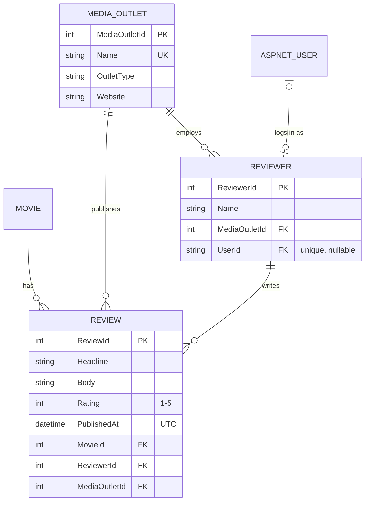

# MovieVault Web API

SW4BAD Mandatory Assignment 3 – Group 5

ASP.NET Core Web API (.NET 10) with Entity Framework Core and SQL Server. All POST, PUT and DELETE requests are logged to MongoDB with Serilog. The consolidated E/R diagram is included in the submission as `MovieVault-ER-diagram.pdf`.

## Group members

| Name | Student number |
|---|---|
| Ayub Mohamed Yusuf | au781514 |
| Mohamad Saleh Yassine | au759451 |
| Jewad Mahouk | au764175 |
| Mohamed Abdirahman Hassan Mahamod | au758453 |

## Contribution report

| Part | Responsible | Contribution |
|---|---|---|
| A. Consolidated E/R diagram | Jewad | Compared the individual diagrams and created the consolidated E/R diagram |
| B. Database implementation with EF Core | Jewad, Mohamed | Jewad: entity classes, primary keys, foreign keys and relationships. Mohamed: DbContext configuration, migrations and seed data |
| C. REST API endpoints | Mohamed | Movie CRUD, cast and filming location operations, screenings and ticket sales with validation |
| D. Query endpoints | Mohamad | Movie overview, movie details, upcoming screenings, ticket sales by movie and actor performance |
| E. Logging to MongoDB | Ayub | Serilog configuration, MongoDB sink and request logging middleware |
| F. OpenAPI + Scalar | Ayub | OpenAPI document, Scalar UI and XML documentation of endpoints |

All group members have reviewed the full solution and can explain every part of it.

## Running the application

### Prerequisites

- .NET 10 SDK
- SQL Server LocalDB (included with Visual Studio)
- MongoDB in Docker or installed locally (optional – without it, requests are only logged to the console)
- EF Core tools: `dotnet tool install --global dotnet-ef`

### Steps

Run from the solution folder:

```bash
# 1. Start MongoDB
docker run -d -p 27017:27017 --name movievault-mongo mongo

# 2. Create the database
dotnet ef database update --project MovieVault.Api

# 3. Run the API
dotnet run --project MovieVault.Api --launch-profile http
```

If the MongoDB container already exists, start it with `docker start movievault-mongo`.

## Database setup and migrations

- **Database:** SQL Server LocalDB, database `MovieVault`
- **Connection string:** `ConnectionStrings:DefaultConnection` in `MovieVault.Api/appsettings.json`
- **Migration:** `InitialCreate` in `MovieVault.Api/Migrations/`. It creates all tables, primary and foreign keys, check constraints and seed data.
- **Seed data:** added with `HasData` in `Data/Seed/`, so it is created together with the migration.
- **Log database:** MongoDB, database `MovieVaultLogs`, collection `RequestLogs` (configured under `Serilog` in `appsettings.json`)

Reset the database:

```bash
dotnet ef database drop --project MovieVault.Api --force
dotnet ef database update --project MovieVault.Api
```

**No LocalDB (e.g. not on Windows)?** Run SQL Server in Docker and override the connection string with user secrets:

```bash
docker run -e "ACCEPT_EULA=Y" -e "MSSQL_SA_PASSWORD=Your_strong_Passw0rd" -p 1433:1433 --name movievault-sql -d mcr.microsoft.com/mssql/server:2022-latest
cd MovieVault.Api
dotnet user-secrets init
dotnet user-secrets set "ConnectionStrings:DefaultConnection" "Server=localhost,1433;Database=MovieVault;User Id=sa;Password=Your_strong_Passw0rd;TrustServerCertificate=True"
```

## URLs

| What | URL |
|---|---|
| API base URL | http://localhost:5019/api |
| Scalar UI | http://localhost:5019/scalar |
| OpenAPI JSON | http://localhost:5019/openapi/v1.json |


## Reviews and media outlets

### Data model



Design decisions:

- **MediaOutlet** stores the outlet's name, type (`Newspaper`, `TvChannel`, `Magazine`, `Radio`, `Online`) and website once. Reviewers and reviews only reference it by foreign key, so outlet data is never duplicated.
- **Reviewer** is the reviewer's profile (name and the outlet they represent). It is linked 1:1 to an ASP.NET Core Identity user through `UserId`, using the same approach as `Actor` and `Director`. The author's name is not stored on the review.
- **Review** stores headline, text, rating (check constraint `Rating BETWEEN 1 AND 5`), publication date (UTC, set by the server) and foreign keys to movie, reviewer and media outlet.
- `Review.MediaOutletId` records the outlet the review was **published in**. It is copied from the reviewer's outlet when the review is created and cannot be changed by the client. This keeps the history correct if a reviewer later moves to another outlet, and makes it simple to find all reviews from one outlet. Only the key is stored, not the outlet's data.
- A movie can have zero reviews (movie 6 has none). Deleting a movie deletes its reviews (cascade). Reviewers and media outlets that still have reviews cannot be deleted (restrict).
- Migration: `AddReviewsAndMediaOutlets`, which extends the existing migration history.

### Endpoints

| Method | Route | Access |
|---|---|---|
| GET | `/api/reviews` | Public. Optional, combinable query parameters `movieId` and `mediaOutletId` |
| GET | `/api/reviews/{id}` | Public |
| POST | `/api/reviews` | Reviewer (as self) and Admin |
| PUT | `/api/reviews/{id}` | Reviewer (own reviews only) and Admin (all) |
| DELETE | `/api/reviews/{id}` | Reviewer (own reviews only) and Admin (all) |
| GET | `/api/media-outlets`, `/api/media-outlets/{id}` | Public (read-only, seeded data) |

Filtering uses query parameters, for example `GET /api/reviews?movieId=1` or `GET /api/reviews?mediaOutletId=1`. An unknown movie or outlet returns 404, and a known one without reviews returns 200 with an empty list.

- The author is always the reviewer linked to the logged-in user (`NameIdentifier` claim in the JWT), never a value from the request body. A Reviewer who sends another `reviewerId` receives 403.
- An Admin creates a review for a reviewer by sending `reviewerId`.
- PUT changes only headline, text and rating. Movie, author, outlet and publication date stay fixed.
- No token → 401. Wrong role, or a Reviewer changing another reviewer's review → 403.

### Demo data

| Account | Reviewer | Media outlet | Owns reviews |
|---|---|---|---|
| `reviewer.demo` | Rita Reel (1) | The Morning Ledger (Newspaper) | 1, 4, 7 |
| `reviewer2.demo` | Jonas Frame (2) | Channel Nord (TV channel) | 2, 6 |
| – | Maja Lens (3) | The Morning Ledger | 5 |
| – | Peter Cutts (4) | Screenwise Magazine | 3 |

Both reviewer accounts use the password from `DemoUsers:Reviewer:Password` (`DEMO_REVIEWER_PASSWORD`). Movie 1 has three reviews from three different outlets. The Morning Ledger has reviews of four different movies.

Ownership demo: log in as `reviewer.demo`, then `PUT /api/reviews/2` → 403, and `PUT /api/reviews/1` → 200.

## Ticket sale simulator

`MovieVault.Simulator` is a .NET Worker Service that periodically creates simulated ticket sales through the MovieVault API. It never accesses the databases directly.

### How it works

Every `Simulator:IntervalSeconds` seconds the simulator runs one round:

1. Logs in with the service account (`POST /api/auth/login`) and reuses the JWT until it is about to expire.
2. Retrieves movies (`GET /api/movies`) and picks a random movie.
3. Retrieves the movie's screenings (`GET /api/movies/{movieId}/screenings`) and keeps those that are `Scheduled`, in the future and have available seats.
4. Picks a random screening and a random number of tickets (1 to `Simulator:MaxTicketsPerSale`).
5. Registers the sale (`POST /api/ticket-sales` with `screeningId` and `totalTickets`).

The simulator only sends `screeningId` and `totalTickets`, exactly like a manual sale. The API sets the price and sale date and checks status, start time and capacity, so simulated sales follow the same business rules. The ticket quantity is deliberately not limited to the available seats; the API is responsible for rejecting sales that would exceed capacity. Accepted sales are stored in SQL Server and included in the existing ticket sales queries.

### Failure handling

| Situation | Behaviour |
|---|---|
| `401 Unauthorized` (token expired or invalid) | Logs in again and retries the request once |
| `400` / `403` / `409` (rejected by a business rule or access control) | Logged as a warning; the simulator continues |
| `5xx`, timeout (10 s) or API not reachable | Exception is caught and logged; the request is retried in the next round |
| Any other exception | Logged as an error; the simulator continues |

The simulator never terminates because of a failed request. During `docker compose up` the first rounds may fail while the API is migrating the database; the simulator then continues automatically.

### Configuration

| Key | Environment variable (Docker) | Default | Description |
|---|---|---|---|
| `MovieVaultApi:BaseUrl` | `MovieVaultApi__BaseUrl` | `http://localhost:5019` | API address. In Docker `http://api:8080` (Compose service name) |
| `ServiceAccount:UserName` | `ServiceAccount__UserName` | – | Service account (Admin role), seeded by the API |
| `ServiceAccount:Password` | `ServiceAccount__Password` | – | Service account password |
| `Simulator:IntervalSeconds` | `Simulator__IntervalSeconds` | `15` | Seconds between simulated sales |
| `Simulator:MaxTicketsPerSale` | `Simulator__MaxTicketsPerSale` | `4` | Maximum tickets in one sale |

In Docker the values come from `.env` through `compose.yaml`. Inside a container `localhost` refers to the container itself, so the simulator uses the service name `api` to reach the API container.

To run the simulator locally against an API started with the `http` profile:

```powershell
cd MovieVault.Simulator
dotnet user-secrets set "ServiceAccount:UserName" "simulator.service"
dotnet user-secrets set "ServiceAccount:Password" "<same password as the API's ServiceAccount:Password>"
dotnet run
```

Follow the simulator in Docker with `docker compose logs -f simulator`.

## Postman tests

The `postman/` folder contains:

- `MovieVault.postman_collection.json` – tests for the Movie controller
- `MovieVault.postman_environment.json` – environment template without secrets

### Setup

1. Import both files in Postman.
2. Select the environment **MovieVault - template**.
3. Fill in `adminPassword` and `actorPassword` with your local demo passwords (the values from `.env`). Do not export or commit the environment with real values.
4. Set `baseUrl` to `http://localhost:5019` (local, `http` profile) or `http://localhost:8080` (Docker Compose).

### Execution order

Run the whole collection with the Collection Runner, in this order. The requests depend on each other through environment variables.

| Folder | Requests | Verifies |
|---|---|---|
| 1. Login | Login as Admin, Login as Actor | 200, token and role. Stores `adminToken` and `actorToken` |
| 2. Authentication - 401 | `GET /api/movies` and `GET /api/movies/1` without token, `GET /api/movies` with invalid token | 401 Unauthorized |
| 3. Movie CRUD - Admin | GET all, GET by id, POST, GET created, PUT | 200/201, response values, `Location` header. Stores `createdMovieId` |
| 4. Authorization - Actor 403 | Actor POST, PUT and DELETE on the test movie | 403 Forbidden |
| 5. Movie CRUD - Admin delete | DELETE test movie, GET it again | 204, then 404 |
| 6. Role-based movie access | Admin `GET /api/movies`, Actor `GET /api/movies`, Actor `GET /api/movies/2` | Admin gets all movies 1–6; Actor (`actor.demo` = Mikkel Strand) gets only movies 1, 3 and 5; Actor gets 403 on movie 2 |

The Actor tests in folder 4 target the test movie created in folder 3, so no seed data is changed if authorization were broken. The collection cleans up after itself and can be run again.